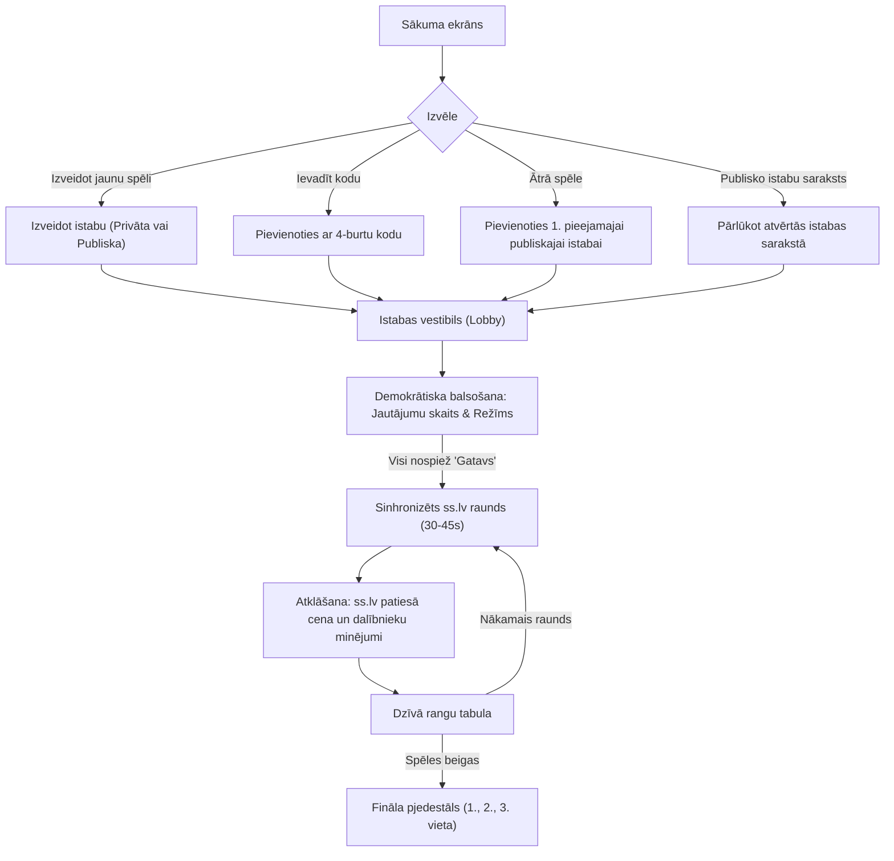

# "MiniCenu" Spēles Izstrādes Plāns — Daudzspēlētāju Ballīšu & Atvērto Istabu Režīms

> **Dokuments:** Izstrādes plāns un progresa ceļvedis  
> **Galvenais fokuss:** Daudzspēlētāju kompānijas spēle 2+ spēlētājiem (*Kahoot / Jackbox* stils) gan **privātās istabās** ar draugiem, gan **atvērtās publiskās istabās**.  
> **Satura avots:** Ekskluzīvi **ss.lv** sludinājumi ar lokālu attēlu glabāšanu un WebP optimizāciju.  
> **Spēles režīmi:** Cenas ierakstīšana (Brīvais minējums) un Atbilžu varianti (4 izvēles / viktorīna).  
> **Tehnoloģiskais steks:** Go (Chi + coder/websocket) + React (Vite, TS, Tailwind) + PostgreSQL 16 (PostGIS) + Redis 7 + Caddy + Docker.

---

## 1. Lietotāja Ceļš un Istabu Veidi

---

## 2. Izstrādes Posmi un Progresa Kontrolsaraksts

### Fāze 1: Repozitorijs, Docker un Datubāzes Shēma
- [x] Izveidot monorepo struktūru: `/backend`, `/frontend`, `/deploy`.
- [x] Sagatavot `docker-compose.dev.yml` ar PostgreSQL 16 (PostGIS) un Redis 7 (porti 5438 & 6385).
- [x] Izveidot `goose` SQL migrācijas:
  - `listings` (ss.lv sludinājumu banka, pareizā cena, kategorija, WebP attēls).
  - `rooms` (istabas kods, host, `is_public`, iestatījumi, statuss).
  - `room_players` (spēlētāja profils, gatavības statuss, punkti).
  - `room_guesses` (spēlētāja minējums, iegūtie punkti, atbildes laiks).
- [x] Konfigurēt `sqlc.yaml` un noģenerēt tipu drošu Go kodu vaicājumiem (`internal/db/sqlc`).

### Fāze 2: ss.lv Sludinājumu Importētājs un Attēlu Dzinējs
- [x] Izveidot Go CLI komandu `cmd/importer/main.go`.
- [x] Implementēt ss.lv datu struktūru (virsraksts, apraksts, cena, kategorija, reģions).
- [x] Izstrādāt attēlu lejupielādes moduli `internal/ss/image.go`.
- [x] Izveidot algoritmu 3 ticamu maldinošo cenu (distractors) ģenerēšanai `internal/ss/distractor.go`.
- [x] Sagatavot un ievadīt datubāzē sākotnējo bāzi ar kvalitatīviem sludinājumiem 4 kategorijās (Auto, Nekustamie īpašumi, Tehnika, Pērles).

### Fāze 3: Go WebSocket Istabu Dzinējs un Balsošana
- [x] Uzstādīt Go `chi` HTTP serveri ar strukturētu žurnālu, CORS un kļūdu apstrādi (`internal/api/routes.go`).
- [x] Implementēt REST endpointus:
  - `POST /api/rooms/create` (izveidot privātu vai atvērtu istabu).
  - `GET /api/rooms/public` (aktīvo publisko istabu saraksts ar spēlētāju skaitu).
  - `POST /api/rooms/quick-join` (ātrā pievienošanās brīvai istabai).
  - `GET /api/rooms/{code}` (istabas stāvoklis).
- [x] Implementēt WebSocket savienojumus ar `coder/websocket` (`internal/websocket/hub.go`).
- [x] Realizēt vestibila balsošanas loģiku ar reāllaika sinhronizāciju:
  - Jautājumu skaits: 5, 10, 15, 20 ar $>50\%$ vairākuma fiksāciju.
  - Spēles režīms: "Ierakstīt cenu" vs "4 Varianti" vs "Jauktais".
- [x] Spēles sinhronizētais taimeris (45s) un automātiska raunda noslēgšana, kad visi atbildējuši.
- [x] Rezultātu aprēķināšana ar Bullseye ($\pm 5\%$) un ātruma bonusiem (`internal/game/scoring.go`).

### Fāze 4: React Frontend UI (Tailwind + TypeScript)
- [x] Izveidot Vite + React 18 + TypeScript + Tailwind projektu uz porta 5185.
- [x] **Sākuma ekrāns (`HomeScreen.tsx`):**
  - Avatara un segvārda profils.
  - Poga "Ātrā spēle" (Quick Play).
  - Poga "Izveidot spēles istabu" (modālais logs: Publiska vai Privāta).
  - Koda ievades lauks privātajām spēlēm.
  - Tiešsaistes atvērto spēļu saraksts ar spēlētāju skaitītājiem.
- [x] **Vestibils (`LobbyScreen.tsx`):**
  - Istabas kods, vienklikšķa kopēšanas poga un uzaicinājuma saite.
  - Dalībnieku saraksts ar avatariem un gatavības indikatoriem.
  - Demokrātiskā balsošana ar reāllaika procentu joslām (5, 10, 15, 20 jautājumi).
  - Gatavības poga ("Nospied, kad esi gatavs!") un administratora "Sākt spēli".
- [x] **Spēles ekrāns (`GameScreen.tsx`):**
  - ss.lv sludinājuma foto ar tālummaiņas iespēju (lightbox).
  - Sinhronizēts 45s atskaites taimeris ar krāsu brīdinājumiem.
  - Režīms "Ierakstīt cenu": pielāgots ciparu lauks (`15 000 €`), ātrās pogas `+100`, `+1k`, `+5k`, `+10k`.
  - Režīms "4 Varianti": 4 lielas krāsainas kartītes ar viena pieskāriena atbildi.
  - "Minējums pieņemts! Gaidām pārējos..." progresa indikators.
- [x] **Atklāšanas ekrāns (`RevealScreen.tsx`):**
  - Dramatiska ss.lv patiesās cenas atklāšana.
  - Dalībnieku minējumu saraksts ar novirzi, Bullseye zelta nozīmīti un punktiem.
  - Dzīvā līderu rangu tabula.
- [x] **Fināla Pjedestāls (`PodiumScreen.tsx`):**
  - 1., 2. un 3. vietas pjedestāls ar konfeti salūtu (`canvas-confetti`).
  - Pilns dalībnieku noslēguma vērtējums.
  - Poga "Spēlēt vēlreiz" un "Doties uz sākumu".

### Fāze 5: Hetzner Izvietošana un Caddy Konfigurācija
- [x] Multi-stage `Dockerfile` Go backendam un React frontendam.
- [x] `deploy/Caddyfile` (HTTPS, WSS, WebP kešs un SPA maršrutēšana).
- [x] `docker-compose.prod.yml` ar Caddy, Go, PostgreSQL 16 (PostGIS) un Redis 7.
